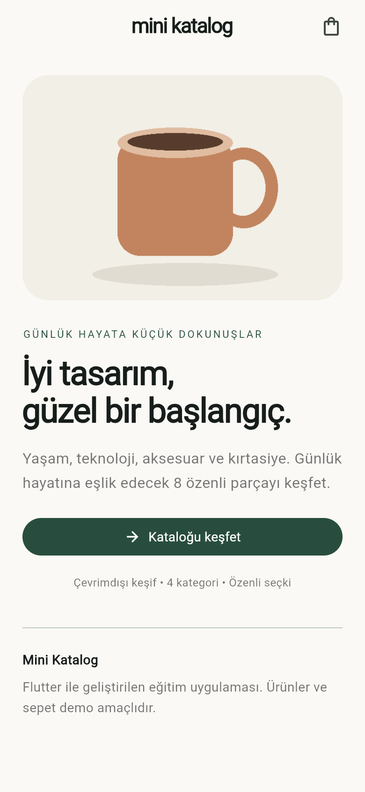
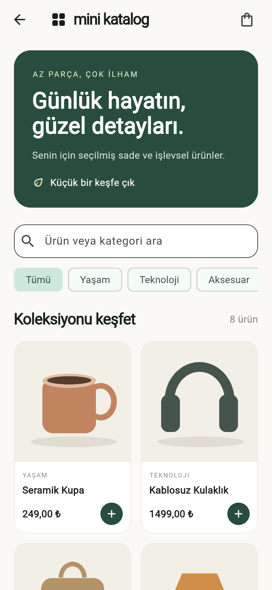
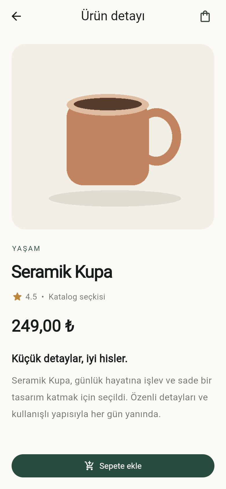
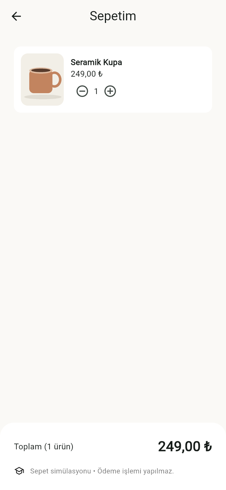

# Mini Katalog

Flutter ile geliştirilmiş, Türkçe arayüzlü ve çevrimdışı çalışan eğitim amaçlı mobil katalog uygulaması. Ana sayfadan ürün koleksiyonuna geçebilir, arama ve kategori filtreleriyle ürün keşfedebilir, detayları inceleyebilir ve sepet simülasyonunu kullanabilirsiniz.

## Geliştirme ortamı

- Flutter **3.47.4**, stable
- Dart **3.13.3**
- Material 3
- Uygulama bağımlılığı: yalnızca Flutter SDK. Harici paket kullanılmaz.
- Test bağımlılığı: Flutter SDK içindeki `flutter_test`.
- Android, iOS ve web platform klasörleri dahildir.

## Çalıştırma

Flutter SDK, VS Code ve Android için Android Studio/Android SDK kurulu olmalıdır. iOS için macOS, Xcode ve uygun simülatör ya da fiziksel cihaz gerekir.

```bash
flutter doctor
flutter pub get
flutter devices
flutter run
```

Android emülatörünü Android Studio Device Manager üzerinden başlatın veya USB hata ayıklaması açık cihaz bağlayın. `flutter run -d CIHAZ_KIMLIGI` ile cihaz seçebilirsiniz.

Tarayıcıda denemek için:

```bash
flutter run -d chrome
```

Doğrulama ve derleme:

```bash
dart format lib test
flutter analyze
flutter test
flutter build web --release
flutter build apk --debug
# macOS + iOS araçları kuruluysa:
flutter build ios --simulator
```

## Özellikler

- Ayrı ana sayfa, ürün listesi, ürün detayı ve sepet ekranları.
- `Navigator.push` / `pop`, `MaterialPageRoute`, named routes.
- Ürün nesnesinin `/product` rotasına `RouteSettings.arguments` ile aktarılması.
- `GridView.builder` ile ekran genişliğine uyumlu ürün kartları.
- `ListView.builder` ile dinamik sepet listesi.
- Büyük/küçük harf ve Türkçe I/İ dönüşümlerini dikkate alan arama.
- Arama ve kategori filtresinin birlikte çalışması; boş sonuç ve filtre temizleme.
- Yerel JSON'dan ürün okuma; `Product.fromJson` / `toJson`.
- `Image.asset` ile 8 yerel ürün illüstrasyonu.
- Sepete ekleme, adet artırma/azaltma, son adet silindiğinde ürünü kaldırma.
- Toplam tutar, sepet rozeti ve boş sepet görünümü.
- JSON yükleme, hata ve yeniden deneme durumları.
- `StatefulWidget`, `setState`, `ChangeNotifier` ve `ListenableBuilder` ile temel state yönetimi.

## Klasör yapısı

```text
lib/
  main.dart                    # Tema, uygulama ve rotalar
  models/product.dart          # Veri modeli ve fiyat biçimleme
  data/catalog_repository.dart # Asset JSON yükleme
  state/cart.dart              # Sepet state ve hesapları
  screens/
    home_screen.dart
    catalog_screen.dart
    detail_screen.dart
    cart_screen.dart
  widgets/cart_button.dart
assets/
  data/products.json
  images/                      # Projeye özel yerel illüstrasyonlar
screenshots/                   # Çalışan uygulamadan ekran görüntüleri
test/widget_test.dart          # Veri, sepet ve kullanıcı akışı testleri
```

## Veri ve eğitim kapsamı

Yönergedeki JSON simülasyonu ve asset yönetimi hedefi için veriler `assets/data/products.json` içinde tutulur. Örnek internet servislerine bağımlılık yoktur; uygulama internet bağlantısı gerektirmez. Ürün isimleri, fiyatlar ve puanlar demo verisidir. Görseller bu proje için hazırlanmıştır.

Sepet yalnızca uygulama çalışırken bellekte tutulur; uygulama yeniden başlatıldığında sıfırlanır. Gerçek sipariş, ödeme, kullanıcı hesabı veya sunucu bağlantısı yoktur.

## Ekran görüntüleri

Görüntüler Flutter'ın çalışan web sürümünden, 390 × 844 mobil görünümde alınmıştır; Android/iOS cihaz görüntüsü olarak sunulmamaktadır.

| Ana sayfa | Katalog |
| --- | --- |
|  |  |

| Ürün detayı | Sepet |
| --- | --- |
|  |  |

## Doğrulama durumu

- `flutter analyze`: sorun yok.
- `flutter test`: 4 test geçti (JSON/model dönüşümü, sepet hesapları, arama/filtre, ana sayfa–detay–sepet akışı).
- `flutter build web --release`: başarılı.
- Chrome'da mobil görünüm ve ürün/sepet etkileşimleri kontrol edildi.
- Bu bilgisayarda Android SDK ve iOS simülatör çalışma zamanı eksik olduğu için Android APK ve iOS cihaz çalışması doğrulanmadı. Platform kaynakları projeye dahildir.

## Teslim

Proje adresi: [sevvalkasan/mini-katalog](https://github.com/sevvalkasan/mini-katalog).

Kaynak kodları, README ve uygulama ekran görüntüleri repository içinde yer alır. Android/iOS cihaz doğrulaması için yukarıdaki ortam gereksinimlerini tamamlayın.
